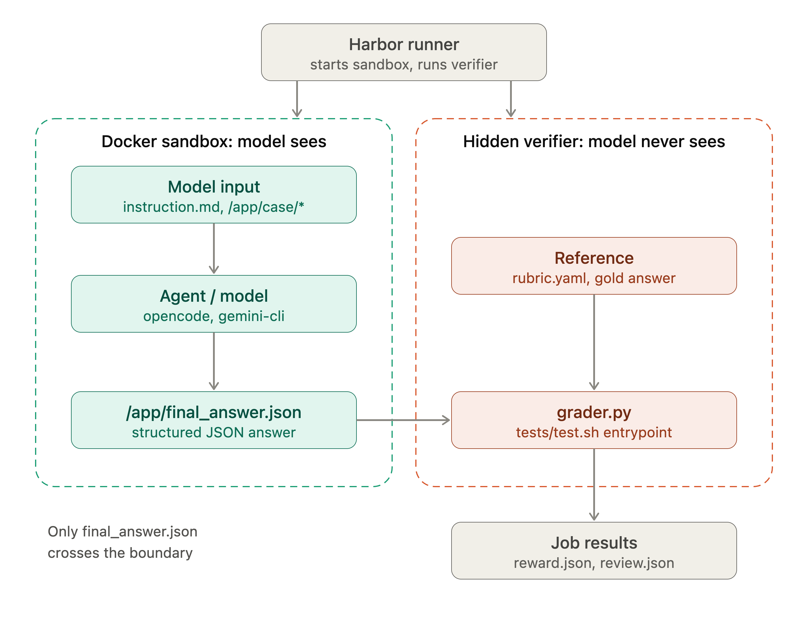
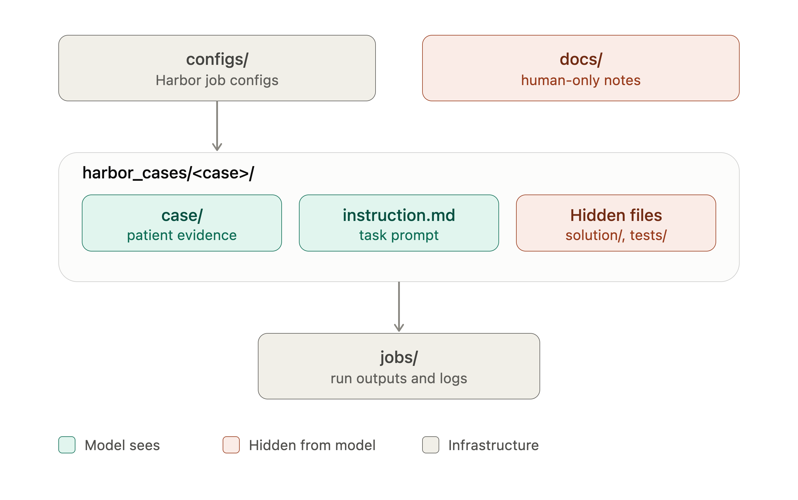
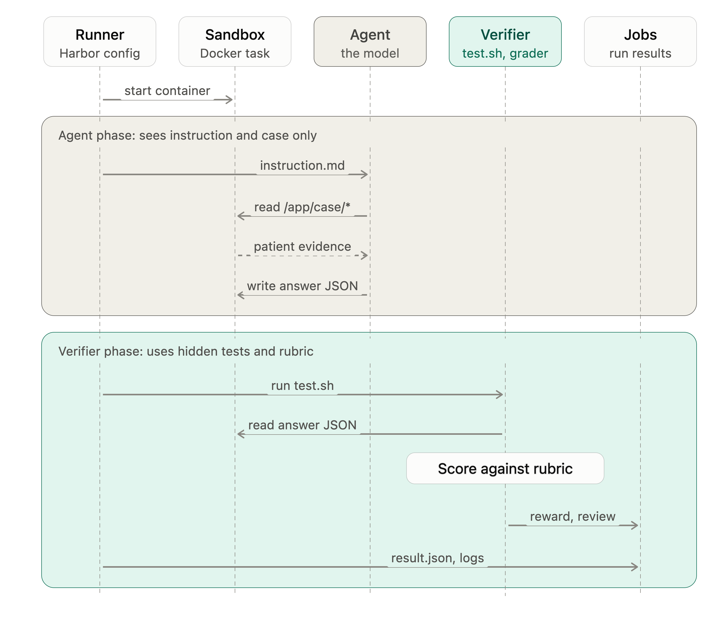
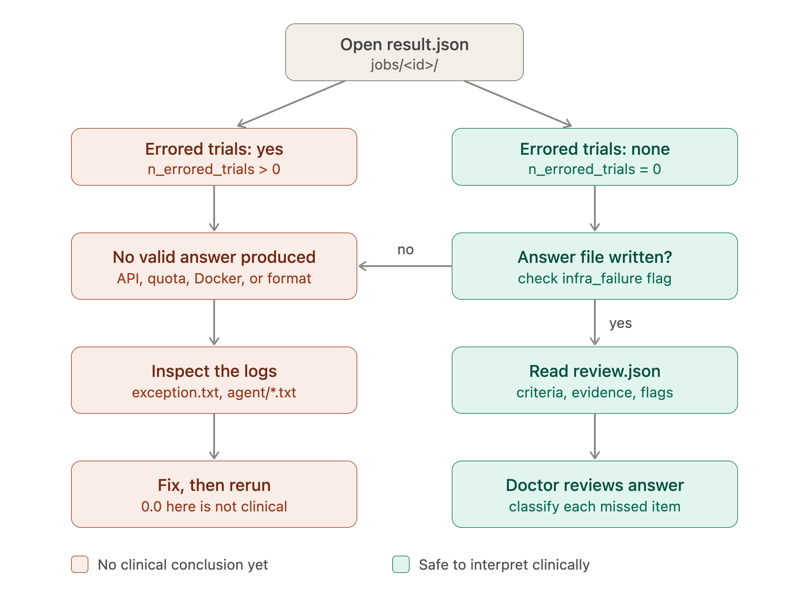

# OncoWorld V1 Simple Guide

OncoWorld is a small evaluation project for testing AI agents on synthetic oncology cases.

The current benchmark asks a model to read a lymphoma case, write a structured clinical answer, and get scored by a hidden verifier.

This is for AI evaluation only. It is not clinical decision support.

## Main Idea

```text
clinical case -> AI agent answer -> hidden doctor-approved grader -> score + review
```

The model does not see the gold answer or the rubric.

## Version Folder

```text
versions/v1/
  README.md
  images/
    01-runtime-flow-and-trust-boundary.png
    02-repo-map-visibility.png
    03-harbor-sequence.png
    04-job-reading-decision-flow.png
  notes/
    oncoworldv1-architecture.md
    harbor-task-components.md
  baseline-notes-2026-10-09.md
```

## Architecture

```text
configs -> Harbor runner -> Docker sandbox -> AI agent -> final_answer.json -> verifier -> jobs
```

### 1. Runtime Boundary

Only the model answer crosses from the model side into the verifier side.



### 2. Repo Visibility

The model sees the case and instructions. It does not see hidden tests, rubric, or gold answers.



### 3. Harbor Sequence

Harbor starts the sandbox, the agent writes an answer, and the verifier scores it.



### 4. Reading A Job

First check whether the job errored. If not, read `review.json` and have the doctor review missed clinical items.



## Text Architecture

```text
configs/
  |
  v
Harbor runner
  |
  v
Docker sandbox for one case
  |
  | model can read:
  | - instruction.md
  | - /app/case/*
  v
AI agent / model
  |
  | writes:
  v
/app/final_answer.json
  |
  v
Verifier
  |
  | hidden from model:
  | - tests/grader.py
  | - tests/rubric.yaml
  | - solution/gold_answer.md
  v
jobs/<run-id>/
  - result.json
  - reward.json
  - review.json
  - logs
```

## Important Folders

```text
configs/
```

Harbor run configs. These say which model to run and which tasks to include.

```text
harbor_cases/
```

All clinical evaluation cases. Each case is self-contained.

```text
jobs/
```

Outputs from Harbor runs.

```text
versions/v1/
```

Versioned V1 architecture guide, diagrams, and notes.

## Case Folder Structure

Each task looks like this:

```text
harbor_cases/<case_id>/
  task.toml
  instruction.md
  environment/
    Dockerfile
    case/
      history.txt
      labs.txt
      imaging.txt
      pathology.txt
  solution/
    final_answer.json
    gold_answer.md
    solve.sh
  tests/
    test.sh
    grader.py
    rubric.yaml
```

## What The Model Sees

The model sees only:

```text
instruction.md
/app/case/*
```

The model must write:

```text
/app/final_answer.json
```

## What The Model Does Not See

The model does not see:

```text
solution/gold_answer.md
solution/final_answer.json
tests/grader.py
tests/rubric.yaml
```

These are used only by the verifier after the model finishes.

## Workflow

1. Doctor or clinical reviewer approves the synthetic case.
2. Engineer creates the Harbor case folder.
3. Doctor approves the hidden gold answer.
4. Engineer writes the grader and rubric.
5. Engineer checks that the gold answer scores `1.0`.
6. Harbor runs the model in a Docker sandbox.
7. Model writes `/app/final_answer.json`.
8. Verifier scores the answer.
9. Doctor reviews important clinical misses.
10. Engineer fixes grader bugs or adds more cases.

## Run Command

Current OpenCode/OpenRouter run:

```bash
harbor run \
  -c ./configs/harbor-opencode-real-eval.json \
  --ae OPENROUTER_API_KEY="$OPENROUTER_API_KEY"
```

View jobs:

```bash
harbor view jobs
```

Watch a job log:

```bash
tail -f jobs/<job-folder>/job.log
```

Inspect result:

```bash
python3 -m json.tool jobs/<job-folder>/result.json
```

Inspect detailed case review:

```bash
python3 -m json.tool jobs/<job-folder>/<trial-folder>/verifier/review.json
```

## Engineer Role

The engineer owns the evaluation system.

Engineer tasks:

- create case folders
- maintain Harbor configs
- write Docker/task setup
- write graders and rubrics
- run Harbor jobs
- inspect logs and failures
- fix grader bugs
- add regression tests
- keep gold answers hidden from the model

The engineer should not add expected answers to visible prompts just to increase score.

## Doctor Role

The doctor owns the clinical truth.

Doctor tasks:

- approve case facts
- approve diagnosis, stage, treatment, and CNS-risk logic
- approve gold answers
- decide what alternatives should get credit
- classify model mistakes as minor, important, or dangerous
- identify clinically wrong grader behavior

## Current Evaluation Set

The main config currently runs:

```text
dlbcl_0001_narrative
dlbcl_0001_fhir
dlbcl_0002_splenic_stage_iii_narrative
dlbcl_0003_renal_adrenal_cns_high_narrative
dlbcl_0004_double_hit_narrative
dlbcl_0005_limited_stage_gcb_narrative
```

These test:

- narrative vs FHIR input
- spleen-only stage III vs true stage IV
- kidney/adrenal high CNS-risk disease
- FISH-positive double-hit lymphoma
- limited-stage low-risk GCB DLBCL

## Good Rule

Fix graders when they misread valid clinical meaning.

Do not leak the answer into the prompt.

## Baseline Notes

Use [baseline-notes-2026-10-09.md](baseline-notes-2026-10-09.md) to track the current old-grader score, patched-grader re-score, and the next clean baseline run.
